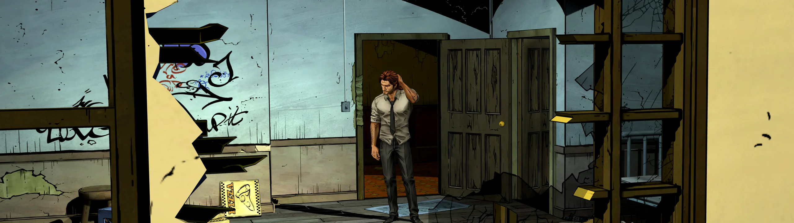

WideOpen
========

Ultrawide fixes for games - plus the settings, debug menus and extras the games hide.
Every fix is drag and drop: one file next to the game's exe, best settings already on.

**Linux / Steam Deck (Proton):** each fix names a Steam launch option to add (for example
`WINEDLLOVERRIDES="dinput8=n,b" %command%`). Windows needs nothing extra.

The Wolf Among Us Remastered ultrawide and wider
------------------------------------------------

Ultrawide and wider (21:9, 32:9, ...) with no stretching and no black bars; inventory and menus fitted to
the screen; better anti-aliasing; FOV options; startup skip; the engine's hidden render settings and
developer menus.

- Download page and instructions: [WideOpen-TWAU-Remastered releases](https://github.com/Lyrixxx/WideOpen-TWAU-Remastered/releases)
- Source: [WideOpen-TWAU-Remastered](https://github.com/Lyrixxx/WideOpen-TWAU-Remastered)
